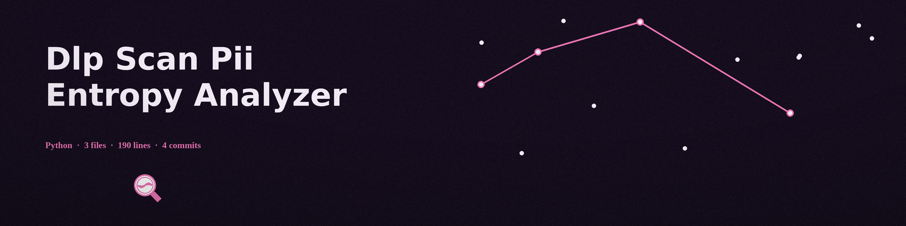

# dlp-scan-PII-Entropy-Analyzer
Analyzes text files for high entropy strings that might indicate leaked cryptographic keys or other sensitive data based on Shannon Entropy. - Focused on Scans local directories and files for sensitive data patterns (e.g., credit card numbers, API keys, PII) using regular expressions and file type identification. Generates reports detailing detected leaks and their severity, with detected values always masked in the report, or deletion (with proper confirmation).

## Install
`git clone https://github.com/ShadowStrikeHQ/dlp-scan-pii-entropy-analyzer`

## Usage
`./dlp-scan-pii-entropy-analyzer [params]`

## Parameters
- `-h`: Show help message and exit
- `--report`: Path to save the report.
- `--mask`: Mask detected sensitive data in report. Masking is now always on, with or without this flag: detected values are never written to the report in clear. The report keeps the file, the pattern type, the position, and the masked length (asterisks). This flag is kept so old commands still run; it changes nothing.
- `--delete`: No description provided
- `--entropy_threshold`: Entropy threshold for considering a string as high entropy.

## Exit status

Exit 0 and the "Scan complete" line are reserved for runs that actually dispatched and completed a scan. A scan path that is neither a file nor a directory, and any unexpected error during a run (for example a report path in a directory that does not exist), exit 1. A missing scan path also exits 1. The --delete option still prompts per file and deletes only on an exact y answer; a declined answer deletes nothing and is recorded in the report without any detected value.

## License
Copyright (c) ShadowStrikeHQ
