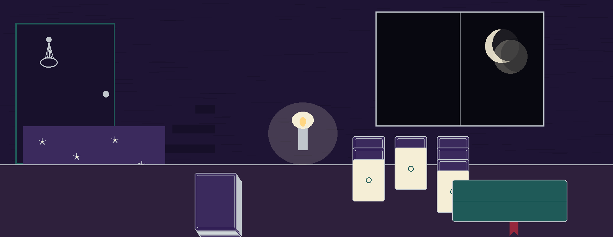
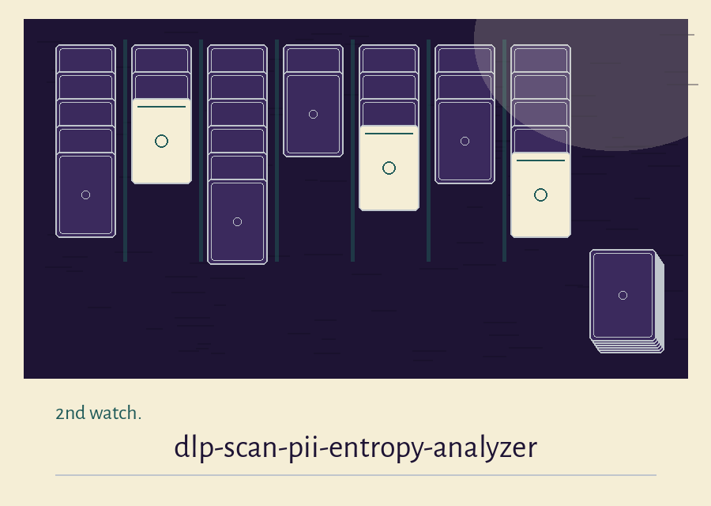
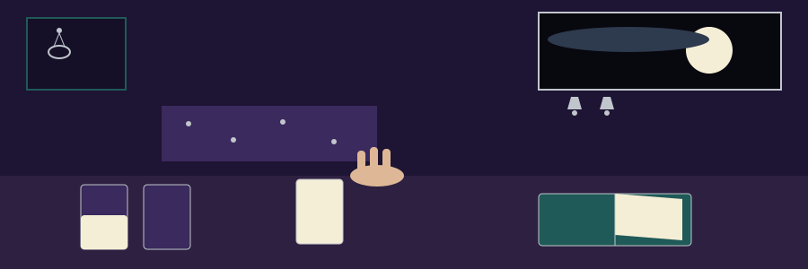

# dlp-scan-pii-entropy-analyzer

Title block: the first entry of the watch log. The name above is set in Brawler in moon cream on a dream violet plate, with an hour style marker at its left, 2nd watch, and a silver rule beneath.

# dlp-scan-PII-Entropy-Analyzer
Analyzes text files for high entropy strings that might indicate leaked cryptographic keys or other sensitive data based on Shannon Entropy. - Focused on Scans local directories and files for sensitive data patterns (e.g., credit card numbers, API keys, PII) using regular expressions and file type identification. Generates reports detailing detected leaks and their severity, with detected values always masked in the report, or deletion (with proper confirmation).

## Install
`git clone https://github.com/ShadowStrikeHQ/dlp-scan-pii-entropy-analyzer`

## Usage
`./dlp-scan-pii-entropy-analyzer [params]`

> Watch note: masking is always on and the mask flag changes nothing. A value found by this program is written as asterisks, at its own length, and never in clear.

## Parameters
- `-h`: Show help message and exit
- `--report`: Path to save the report.
- `--mask`: Mask detected sensitive data in report. Masking is now always on, with or without this flag: detected values are never written to the report in clear. The report keeps the file, the pattern type, the position, and the masked length (asterisks). This flag is kept so old commands still run; it changes nothing.
- `--delete`: No description provided
- `--entropy_threshold`: Entropy threshold for considering a string as high entropy.

> Watch note: one string may be counted under several pattern shapes at once. The report counts per pattern, not per distinct secret.

> Watch note: a file skipped for its type or its encoding is a skip, not a clean bill. The log names the skip and the scan moves on.

## Exit status

Exit 0 and the "Scan complete" line are reserved for runs that actually dispatched and completed a scan. A scan path that is neither a file nor a directory, and any unexpected error during a run (for example a report path in a directory that does not exist), exit 1. A missing scan path also exits 1. The --delete option still prompts per file and deletes only on an exact y answer; a declined answer deletes nothing and is recorded in the report without any detected value.

> Watch note: deletion asks out loud and only ever happens at a keyboard. One letter, y, either case, removes the file. Any other answer keeps it.

## License
Copyright (c) ShadowStrikeHQ

## Watch notes, gathered at the table

The buttons of this re-skin read Turn the First Card, Read the Night Report, and Show the Watch Log. Its headings read Four Shapes Sought, Randomness Weighed by the String, Skipped Files Are Named in the Log, Masked at Every Length, and One Exit for a Finished Watch. Identity faults stand as printed above and are flagged here, not repaired: the install line and the licence line name ShadowStrikeHQ, the organisation this project does not belong to, 2 times in all. The correct form, ShadowGuard-AI, appears 0 times in the live text, and the unhyphenated form appears 0 times. The preserved heading restyles the repo name with capitals the repo does not use. Repairs belong on the website, where they are labelled as repairs. The repository LICENSE file carries the MIT License; its holder line gives a pen name first, a parenthetical given name with a single initial after it, and a handle last. The initial is not expanded here.
